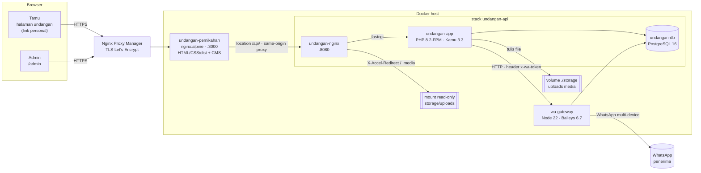
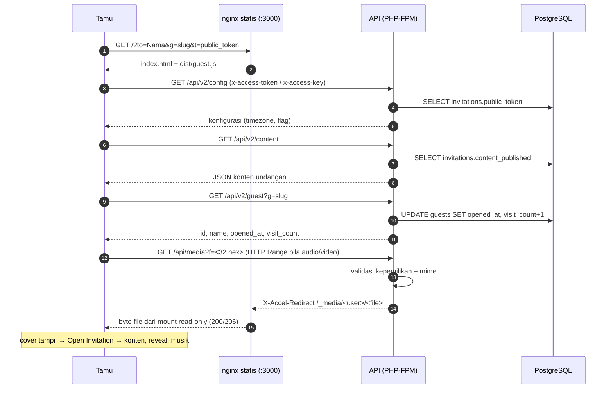
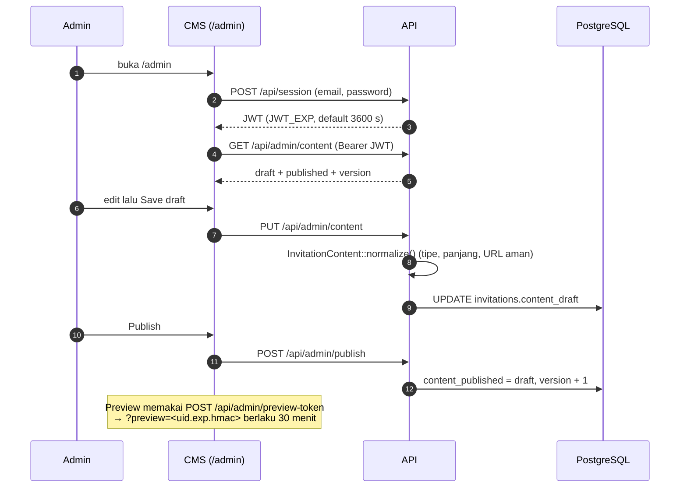
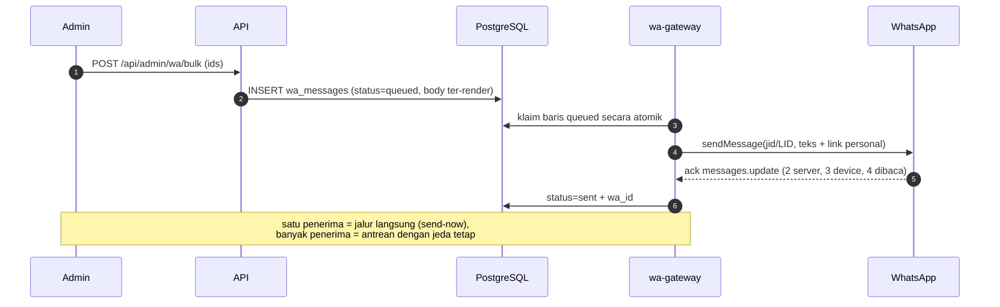

# Undangan Pernikahan Digital + CMS

Undangan pernikahan online untuk **satu pasangan** (bukan SaaS multi-tenant), dikelola sepenuhnya dari browser lewat CMS **Studio Undangan** di `/admin`.


---

## Daftar Isi

1. [Fitur](#1-fitur)
2. [Tech Stack](#2-tech-stack)
3. [Arsitektur](#3-arsitektur)
4. [Alur Sistem](#4-alur-sistem)
5. [Struktur Repo](#5-struktur-repo)
6. [Database](#6-database)
7. [API](#7-api)
8. [Menjalankan](#8-menjalankan)
9. [Operasional](#9-operasional)
10. [Keamanan](#10-keamanan)
11. [Kredit & Lisensi](#11-kredit--lisensi)

---

## 1. Fitur

### Halaman tamu (`/`)

- Cover dengan nama tamu personal: `/?to=Nama&g=slug&t=public_token`
  (tautan lama `&k=access_key` tetap diterima, jadi link yang sudah tersebar tidak mati)
- Hitung mundur, jadwal akad & resepsi, lokasi + Google Maps, dress code
- Love story, galeri carousel, love gift (transfer / QRIS / hadiah)
- Ucapan & RSVP: hadir / tidak hadir, balasan, like, moderasi
- Musik latar (dari galeri media atau lagu bawaan), pemutar play/pause
- Tema & efek: 9 preset palet, warna kustom, font judul/isi, animasi reveal,
  transisi cover (curtain / fade / zoom / flip), confetti, kelopak, overlay, kilau kursor
- Urutan section bisa diatur ulang dan sebagian disembunyikan
- Pelacakan kunjungan: `opened_at` (pertama dibuka) + `visit_count` per tamu
- Konten dihidrasi dari API saat dibuka; kalau API gagal, markup statis tetap tampil (fail-open)
- **Lagu tidak diunduh saat boot** — baru diambil setelah tamu menekan *Open Invitation*
- **Media dilayani langsung oleh nginx** (`X-Accel-Redirect`), mendukung HTTP Range/206 sehingga
  audio bisa di-stream dan video di-seek
- Payload awal ±2,4 MB (gambar sudah WebP q80; audio 96 kbps stereo ±2,3 MB menyusul saat dibuka)

### Studio Undangan (`/admin`)

- **Dashboard** — total undangan, sudah dibuka / belum dibuka, tingkat dibuka, RSVP, kelengkapan konten, status publikasi
- **Profil Mempelai** — nama, orang tua, foto, deskripsi
- **Info Pernikahan** — tanggal & zona waktu, countdown, akad/resepsi, venue, Maps, dress code
- **Konten Undangan** — opening, kutipan, love story, galeri, love gift, penutup
- **Media** — upload/preview/replace/delete + kompres otomatis, dipakai lintas field
- **Urutan Section** — ubah urutan & sembunyikan section
- **Daftar Tamu** — CRUD, link personal, status dibuka (jumlah kunjungan), status & isi RSVP, export CSV
- **Ucapan & RSVP** — moderasi: edit nama/kehadiran/isi, balas sebagai mempelai, hapus, like, cari, export CSV
- **Kirim WhatsApp** — per tamu atau massal, jeda tetap anti-ban, kuota harian, log status
- **Tema & Efek** — 5 tab: tema, warna, gerak, efek, latar
- **Tipografi & Musik** — katalog 53 keluarga font, lagu dari galeri media
- **Publikasi** — draft vs published (versi naik), revert, preview token, URL, SEO
- **Akun & Keamanan** — profil, zona waktu, izin tamu, filter kata, ganti password

### WhatsApp

- Gateway Baileys: kirim template personal `{nama}` + `{link}` lengkap dengan preview link
- Antrean di dalam gateway, jeda tetap, kuota harian, jendela jam, validasi nomor `onWhatsApp`
- Status pesan dari ack WhatsApp (`messages.update`: 2 server, 3 diterima, 4 dibaca)

### Ketahanan & operasional

- **Header keamanan** di semua halaman: CSP, X-Frame-Options, nosniff, Referrer-Policy,
  Permissions-Policy, HSTS — dijaga satu snippet (`security-headers.conf`) agar tidak hilang
  saat sebuah `location` punya `add_header` sendiri
- **Rate limit terarah**: `POST /api/session` 6/menit (brute force), `POST /api/comment` 2/detik;
  GET konten sengaja **tidak** dibatasi agar tamu di balik CGNAT tidak saling menendang
- **Backup otomatis**: `pg_dump -Fc` tiap jam + arsip media harian, retensi 14 hari, salinan off-host
- **Monitoring**: probe `/api/v2/config` tiap 2 menit, alert setelah 3 kegagalan berturut + notifikasi pulih
- **PHP**: `display_errors=Off`, `expose_php=Off`, `request_terminate_timeout=300s`,
  `pm.max_children=8`, `pm.max_requests=500`

---

## 2. Tech Stack

| Lapisan | Teknologi | Versi | Catatan |
|---|---|---|---|
| Markup & style | HTML5, CSS3 (custom properties) | — | Bootstrap 5.3.8 + Font Awesome 7.1.0 dari CDN, di-pin dengan SRI |
| Frontend JS | Vanilla ES Modules (tanpa framework) | ES2020+ | 2 entry: `js/guest.js`, `js/cms.js` |
| Bundler | esbuild | ^0.25.10 | `npm run build` → `dist/guest.js`, `dist/cms.js` |
| Web server | nginx (`nginx:alpine`) | 1.27 | CSP + header keamanan (`security-headers.conf`), gzip, cache split (`no-store` untuk JS/CSS/HTML), `limit_req` login & komentar, proxy same-origin `/api/` |
| API | PHP-FPM (`php:8.2-fpm`) | 8.2 | ext: `pdo_pgsql`, `gd` (+webp, freetype), `exif`, `intl`, `bcmath`, `mbstring`, `opcache`; pool tuning di `api/php-fpm-tuning.conf` |
| Framework | Kamu Framework | ^3.3 | Router, Model/Query, Middleware, Validator, JWT via `firebase/php-jwt` ^6.3 |
| Database | PostgreSQL (`postgres:16-alpine`) | 16 | Volume `undangan-api_postgres_data` |
| API web server | nginx (`nginx-unprivileged`) | — | `:3001 → :8080`, fastcgi ke `app:9000` (di-resolve ulang tiap 10 s), `/_media/` internal untuk `X-Accel-Redirect` |
| WA gateway | Node (`node:22-bookworm-slim`) + Express | 22 / ^4.21 | `@whiskeysockets/baileys` 6.7.24, `pino`, `qrcode`, `pg`, `link-preview-js` |
| Orkestrasi | Docker Engine + Compose | 29 / v5 | Healthcheck, resource limit, `no-new-privileges`, `cap_drop: ALL` |
| Edge / TLS | Nginx Proxy Manager (openresty) | v2.14 | Terminasi TLS Let's Encrypt, proxy ke `:3000` |
| Tooling dev | eslint 9, stylelint 16, htmlhint, madge | — | `npm run lint:js`, `lint:css`, `lint:html` |

Runtime: **5 container aplikasi** — `undangan-pernikahan` (statis), `undangan-nginx`, `undangan-app`, `undangan-db`, `wa-gateway` — plus reverse proxy TLS di edge.

---

## 3. Arsitektur



Catatan desain:

- **Satu origin.** Halaman statis mem-proxy `/api/` ke container API, jadi tidak ada CORS,
  tidak perlu subdomain API, dan tidak ada mixed content. `data-url="/"` di `index.html`.
- **Media tidak di docroot.** URL publik tetap `GET /api/media?f=<32 hex>` (nama acak), tetapi PHP
  hanya memvalidasi lalu menyerahkan byte ke nginx lewat `X-Accel-Redirect: /_media/<user>/<file>`.
  Lokasi `/_media/` bertanda `internal` (tidak bisa diakses langsung) dan mendukung Range/206.
- **Konten adalah JSON.** Semua teks/foto/lagu disimpan di `invitations.content_draft` /
  `content_published`; frontend merender dari situ, bukan hardcode di HTML.

---

## 4. Alur Sistem

### 4.1 Tamu membuka link personal



Kunjungan dihitung **satu kali per page load** dan hanya kalau URL membawa `?g=` (link personal).

### 4.2 Admin mengubah konten lalu publish



### 4.3 Kirim undangan lewat WhatsApp



---

## 5. Struktur Repo

```
.
├── frontend/                 # halaman tamu + CMS (statis)
│   ├── index.html            # halaman undangan (data-key = access key, isi sendiri)
│   ├── admin.html            # Studio Undangan
│   ├── css/                  # theme.css, guest.css, cms.css
│   ├── js/
│   │   ├── guest.js          # entry halaman tamu
│   │   ├── cms.js            # entry CMS
│   │   ├── app/guest/        # content, image, video, audio, reveal, fx, transitions, layout
│   │   ├── app/cms/          # api, ui, store, shell, panels, theme, layout, rsvp, account
│   │   ├── common/           # fonts.js, appearance.js, theme-presets.js
│   │   └── libs/             # loader, util
│   ├── assets/               # fonts (53 keluarga woff2), icons, images
│   ├── tools/                # fetch-fonts.mjs, og-sync.py
│   ├── nginx.conf            # CSP, gzip, cache, limit_req, proxy /api/
│   ├── security-headers.conf # snippet header keamanan (di-include tiap location)
│   ├── Dockerfile            # node:20 build → nginx:alpine
│   └── docker-compose.yml
├── api/                      # REST API (Kamu Framework)
│   ├── app/Controllers/Api/  # Auth, Cms, Comment, Dashboard, Guest, Media, Wa
│   ├── app/Middleware/       # Auth, Dashboard, IpUserAgent, RateLimit
│   ├── app/Models/           # User, Invitation, Comment, Like, Guest, Media, Wa*
│   ├── app/Support/          # InvitationContent (skema + default + normalize)
│   ├── database/schema/      # migrasi + cms.sql
│   ├── routes/api.php
│   ├── api/php-fpm-tuning.conf # override pool: worker, timeout
│   ├── docker/{php,nginx}/   # Dockerfile php:8.2-fpm + default.conf
│   └── docker-compose.yml    # db + app + nginx
├── wa-gateway/               # gateway WhatsApp (Baileys)
│   ├── src/src/              # index.js (HTTP), wa.js (socket), queue.js, db.js, config.js
│   ├── src/Dockerfile
│   ├── docker-compose.yml
│   └── .env.example
├── docs/                     # DEV-ENVIRONMENT.md, FONT-DAN-MUSIK.md, RENCANA-PERBAIKAN.md
└── README.md
```

Repo ini adalah **mirror kode**, bukan salinan mentah produksi: tanpa `.env`, tanpa `storage/`,
tanpa media pribadi (`assets/images/dj`, `assets/music`, `assets/video`, `assets/images/og`),
tanpa `node_modules`, `dist`, dan `vendor`.

---

## 6. Database

PostgreSQL 16, 9 tabel (`api/database/schema/`):

| Tabel | Isi |
|---|---|
| `users` | Pemilik undangan: email, password (bcrypt), `access_key` (dipakai `data-key`), timezone, izin fitur |
| `invitations` | `content_draft` / `content_published` (JSON), `version`, `is_live`, `published_at`, `public_token` (48 hex, dipakai tautan tamu) |
| `media` | Metadata upload: nama acak, mime, size, `kind`, width/height |
| `guests` | Tamu: `slug` unik, nama, telepon, kategori, catatan, `sent_at`, `opened_at`, `visit_count` |
| `comments` | Ucapan & RSVP: `presence`, isi, `parent_id` (balasan), `guest_id` |
| `likes` | Like per ucapan (idempoten per pengirim) |
| `wa_sessions` | Status sesi WhatsApp + QR |
| `wa_messages` | Antrean & log kirim: `queued → sending → sent/failed/skipped`, template ter-render |
| `wa_settings` | Template pesan, jeda, kuota harian, jendela jam, pause |

Semua data di-scope `user_id` (1 user = 1 undangan). Tidak ada kolom `is_admin`;
status admin ditentukan oleh ada/tidaknya JWT yang valid.

---

## 7. API

```
POST   /api/session                    login admin → JWT
GET    /api/v2/config                  konfigurasi publik (butuh x-access-key)
GET    /api/v2/content                 konten published (?preview=<token> untuk draft)
GET    /api/v2/guest?g=<slug>          resolusi link tamu + catat kunjungan
GET    /api/v2/comment?q=&per=&next=   daftar ucapan (publik)
POST   /api/comment                    kirim ucapan / balasan
PUT    /api/comment/{own}              edit ucapan (admin boleh ubah nama)
DELETE /api/comment/{own}              hapus ucapan + balasan
POST   /api/comment/{uuid}             like
PATCH  /api/comment/{uuid}             unlike
GET    /api/media?f=<32 hex>           sajikan media publik
GET    /api/admin/overview             ringkasan dashboard (termasuk guest_open)
GET    /api/admin/content              draft + published + versi
PUT    /api/admin/content              simpan draft (normalize)
POST   /api/admin/publish              publish draft (versi + 1)
POST   /api/admin/revert               kembalikan draft ke published
POST   /api/admin/preview-token        token preview draft (HMAC, 30 menit)
GET/POST/PUT/DELETE /api/admin/media[/{id}]        kelola media (+ /optimize)
GET/POST/PUT/DELETE /api/admin/guests[/{id}]       kelola tamu
GET    /api/admin/guests/export        CSV tamu (+ kolom dibuka, kunjungan)
POST   /api/admin/guests/{id}/sent     tandai undangan terkirim
GET/POST /api/admin/wa/...             status, start, logout, qr, settings, messages, send, bulk, queue
GET    /api/download                   CSV ucapan
GET    /api/user · PATCH /api/user     profil & izin admin
GET    /api/stats                      statistik ucapan
PUT    /api/key                        rotasi access key (hati-hati: data-key harus ikut diganti)
```

Semua endpoint API mewajibkan salah satu kredensial berikut, plus User-Agent ≥ 64 karakter
(`IpUserAgentMiddleware`); pengecualian: `/` dan `/health`.

| Kredensial | Header | Scope |
|---|---|---|
| Token publik undangan | `x-access-token: <48 hex>` | tamu (konten, komentar, tracking) |
| Access key lama | `x-access-key: <50 alnum>` | tamu — dipertahankan untuk tautan yang sudah tersebar |
| JWT admin | `Authorization: Bearer <jwt>` | penuh, termasuk `/api/admin/*` |

Middleware mencoba `x-access-token` lebih dulu, lalu jatuh ke `x-access-key`, sehingga kedua format
tautan hidup berdampingan.

---

## 8. Menjalankan

### 8.1 Database + API

```bash
cd api
cp .env.example .env      # isi APP_KEY, DB_PASS, JWT_KEY, WA_GATEWAY_URL, WA_TOKEN
docker network create undangan-shared          # sekali saja
docker compose up -d --build                   # db + app + nginx
docker exec undangan-app php saya migrasi      # terapkan skema
docker exec undangan-db psql -U undangan_user -d undangan -c '\dt'
chown -R 33:33 storage                         # kalau upload gagal (www-data = uid 33)
```

> Runner `php saya migrasi` mengeksekusi **semua** file migrasi setiap kali (tanpa tabel pelacak),
> jadi untuk database yang sudah hidup gunakan DDL idempoten `database/schema/cms.sql` lewat `psql`.

Image API memakai `.dockerignore` + **BuildKit secret** untuk `.env` (dipakai `php saya view:cache`
saat build), jadi kredensial tidak pernah masuk layer image. Build butuh BuildKit aktif:

```bash
DOCKER_BUILDKIT=1 docker compose build app
docker run --rm --entrypoint sh undangan-api-app -c 'ls /var/www/.env'   # harus "No such file"
```

### 8.2 Halaman undangan + CMS

```bash
cd frontend
npm install
npm run build        # dist/guest.js, dist/cms.js
docker compose up -d --build
```

Sebelum dipakai, sesuaikan `frontend/index.html`:

- `data-key` → access key milik user undangan (dari `users.access_key` / panel Akun)
- `data-url="/"` → biarkan relatif; nginx mem-proxy `/api/` ke container API
- nama domain pada tag SEO/OG (`meta.url`, `canonical`)

`dashboard.html` (dashboard template lama) sudah dihapus — CMS sepenuhnya di `admin.html`.
Route `/dashboard` mengembalikan 404.

### 8.3 WA gateway (opsional)

```bash
cd wa-gateway
cp .env.example .env      # DB_* + WA_TOKEN (harus sama dengan api)
docker compose up -d --build
# lalu dari CMS: Kirim WhatsApp → Hubungkan → scan QR
```

---

## 9. Operasional

- **Deploy web** (< 1 menit): `cd frontend && docker compose build && docker compose up -d`.
  Image mem-*bake* folder `public/`, jadi mengubah file di host saja tidak cukup —
  `docker cp` ke `/usr/share/nginx/html/...` atau rebuild.
- **Stamp aset**: `index.html`/`admin.html` memuat `?v=<stamp>` untuk `dist/*.js` dan `css/*.css`.
  Naikkan stamp tiap perubahan frontend supaya klien tidak memakai bundel lama dari cache.
- **Deploy API** (± 5 menit): `cd api && docker compose build app && docker compose up -d app`,
  lalu `chown -R 33:33 storage`. Jalankan `php -l` untuk file PHP yang diubah sebelum build.
- **Preview OG**: `frontend/tools/og-sync.py` (cron tiap 5 menit) membuat
  `assets/images/og/og-<hash>.jpg` 1200×630 dari `meta.og_image` / `cover.photo`
  dan mem-patch blok `og:image` di `index.html`.
- **Cache build Docker** cepat membengkak setelah beberapa kali build: `docker builder prune -f`.
- **Media**: upload dikompres otomatis (resize sisi terpanjang 1600 → WebP q82) lewat GD;
  tombol ↻ di panel Media mengoptimasi file lama. Nama file tidak diubah agar URL tetap valid.
  Penyajian byte dilakukan nginx (`X-Accel-Redirect`), bukan `readfile()` PHP.
- **Gambar halaman** di produksi sudah dinormalkan ke WebP q80 (sisi panjang 1200–1400) dan audio
  ke 96 kbps stereo 44,1 kHz; kalau mengganti file secara manual, perbarui juga `size`/`width`/`height`
  di tabel `media` (ETag = `md5(filename|size)`).
- **Backup** (`scripts/undangan-backup.sh`): `pg_dump -Fc` tiap jam, arsip `storage/uploads` harian,
  retensi 14 hari. Salinannya ditarik ke host lain (`pull-backup.sh`, retensi 21 hari).
- **Monitoring** (`scripts/undangan-health.sh`): probe `/api/v2/config` tiap 2 menit; alert setelah
  3 kegagalan berturut dan notifikasi saat pulih. Endpoint `/health` statis tidak dipakai karena
  tidak menyentuh API/DB.
- **Rollback**: tag image sebelum deploy (`docker tag <image> <image>:prev-<tanggal>`); untuk stack API
  `docker compose up -d app` setelah me-retag `:prev` sudah cukup.
- **Dashboard lama dihapus**: `frontend/dashboard.html`, entri `build:public` di `package.json`, dan
  route `/dashboard` (kini 404).

---

## 10. Keamanan

- `.env` (berisi `DB_PASS`, `JWT_KEY`, `APP_KEY`, `WA_TOKEN`) **tidak** ada di repo — ambil dari `.env.example`.
- `frontend/index.html` di repo memakai placeholder `data-key="ISI_DENGAN_ACCESS_KEY_UNDANGAN"`.
- **Kredensial tidak masuk image**: `.dockerignore` mengecualikan `.env`; build memakai BuildKit
  secret. Verifikasi: `docker run --rm --entrypoint sh <image> -c 'ls /var/www/.env'` → tidak ada file.
- **Tautan tamu memakai token per undangan** (`invitations.public_token`, 48 hex) yang hanya memberi
  scope tamu. `access_key` tetap diterima untuk kompatibilitas tautan lama, tetapi tidak lagi dicetak
  di tautan baru.
- Admin memakai JWT dari `POST /api/session`; tidak ada kolom role — setiap user aktif dianggap admin,
  karena instalasi ini satu pasangan. Nonaktifkan akun seed sebelum dipakai publik.
- **Rate limit** di nginx (`limit_req`): 6/menit untuk login, 2/detik untuk kirim komentar.
  Middleware `RateLimitMiddleware` (MongoDB) tetap ada tetapi nonaktif bila env Mongo kosong.
- **Header keamanan** dijaga satu snippet dan di-include di setiap `location` yang punya `add_header`
  sendiri — memeriksa config saja tidak cukup, verifikasi dengan `curl -sSI`.
- Media hanya disajikan lewat API dengan nama file acak 32 hex, dan byte-nya dari lokasi `internal`
  nginx (tidak bisa diakses langsung).
- Validasi upload: foto ≤ 12 MB, audio ≤ 20 MB, video ≤ 40 MB (`client_max_body_size 64m`);
  `request_terminate_timeout=300s` memberi ruang upload lambat tanpa menggantung worker selamanya.
- Rotasi access key (`PUT /api/key`) memutus hidrasi konten & komentar sampai `index.html`
  diperbarui dan di-rebuild — jangan dilakukan tanpa mengganti `data-key` sekaligus.
- Rotasi `DB_PASS` **wajib** diikuti pembaruan `.env` di `wa-gateway`; kalau tidak, gateway kehilangan
  koneksi DB dan sesi WhatsApp perlu di-pair ulang.

---

## 11. Kredit & Lisensi

- Halaman undangan dan komponen awalnya berbasis [dewanakl/undangan](https://github.com/dewanakl/undangan) (MIT).
- API memakai [Kamu Framework](https://github.com/kamu/framework) (MIT).
- Lapisan CMS, hidrasi konten, pelacakan pembukaan undangan, moderasi RSVP,
  manajemen media/tamu, tema & efek, dan gateway WhatsApp dibangun di atasnya.

MIT — lihat `frontend/LICENSE`.